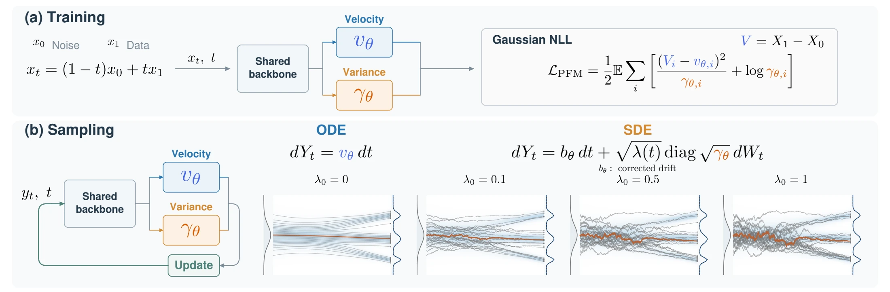

# Posterior Flow Matching

Learn conditional velocity means and variances for generation and endpoint-posterior diagnostics.

**Chenrui Ma, Xi Xiao, Lin Zhao, Xinru Jiang, Tianyang Wang, Yanning Shen, Nando Fioretto**

[Paper (PDF)](https://merry7cherry.github.io/posterior-flow-matching/assets/paper.pdf) · [Project page](https://merry7cherry.github.io/posterior-flow-matching/) · [Citation](CITATION.cff)

PFM learns a Gaussian velocity posterior with a joint negative log-likelihood
objective. One trained model supports mean-driven ODE sampling, posterior-driven
SDE sampling, and endpoint mean/variance readouts. Endpoint covariance is
`(1-t)^2` times velocity covariance.



## Code

The four applications are parallel directories in this repository. Choose a task
and follow its README. Each task has its own environment, data, models and metrics;
there is no root-level Python installation or cross-task runtime dependency.

| Task | Implementation and setup | Data |
| --- | --- | --- |
| Images | [images/](images/) | CIFAR-10, ImageNet-256; MNIST CPU example |
| Point clouds | [pointcloud/](pointcloud/) | ShapeNet Chair and Airplane |
| Molecules | [molecules/](molecules/) | GEOM-QM9 conformations |
| Actions | [pusht/](pusht/) | Image-conditioned PushT |

Each task follows **data → PFM training → ODE/SDE sampling → task evaluation →
posterior diagnostics**. Checkpoints and generated results are ordinary files that can be loaded directly.

```bash
git clone https://github.com/merry7cherry/posterior-flow-matching.git
cd posterior-flow-matching
# Choose images/, pointcloud/, molecules/ or pusht/ and follow that README.
```

The image implementation supports velocity-mean and endpoint-mean parameterizations
of the same PFM. Point clouds retain joint latent-prior learning, molecules retain
centered equivariant geometry, and PushT retains its native observation/action loop.
Task-specific structures implement the same learning and sampling formulation.

## CPU examples and verification

Each task README contains a small CPU workflow and links its verification record.
These exercise model/loss, sampling and task interfaces; their outputs are not
paper-quality results. Full training is expensive. No pretrained PFM weights or
datasets are bundled, and CPU checks do not establish GPU execution or the paper's
reported metrics. The project page reports the paper's experiments.

## Project page and paper

[`website/`](website/) contains the shared static project page for all four tasks.
The Paper link currently opens the authors' preprint PDF. An arXiv link will be
added when the submission is available.

## Citation and licenses

Please cite *Posterior Flow Matching* (2026 preprint); [CITATION.cff](CITATION.cff)
contains the paper record. Retained backbones and task code keep their upstream
licenses and attribution within each task directory. See
[THIRD_PARTY_NOTICES.md](THIRD_PARTY_NOTICES.md) for the license map.
